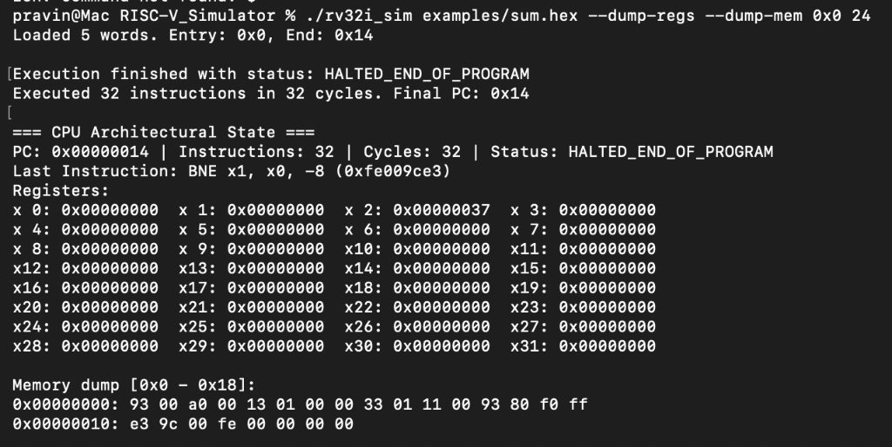
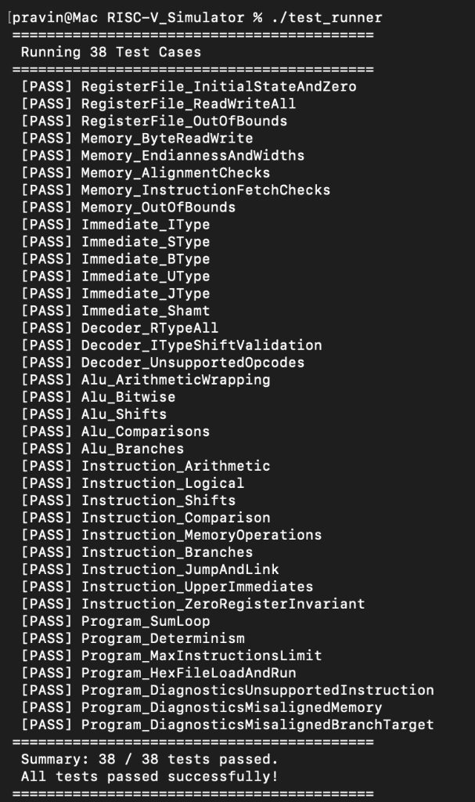

# RV32I RISC-V Processor Simulator

A modular, deterministic, single-cycle RV32I RISC-V processor simulator in C++17 implementing the exact 37-instruction subset specified in Section 3 of the PRD.

## Execution & Test Verification

### 1. Program Execution
Running the sample summation program (`examples/sum.hex`), which iteratively calculates $\sum_{i=1}^{10} i = 55$ (`0x37`):



*Figure 1: `./rv32i_sim` executing `examples/sum.hex`. The simulator halts cleanly at `HALTED_END_OF_PROGRAM` after 32 instructions/cycles, verifying `x2 = 0x00000037` (55), counter `x1 = 0x0`, `x0 = 0x0`, and displaying memory contents.*

### 2. Comprehensive Test Suite
Running the zero-dependency test runner (`./test_runner`):



*Figure 2: All 38 test suites passing with 100% success rate, validating every single instruction in the RV32I specification, memory alignments, register bounds, and error diagnostics.*

---

## Supported Instructions (Exactly 37)

| Category | Instructions |
|---|---|
| Arithmetic | `ADD`, `SUB`, `ADDI` |
| Logical | `AND`, `OR`, `XOR`, `ANDI`, `ORI`, `XORI` |
| Shifts | `SLL`, `SRL`, `SRA`, `SLLI`, `SRLI`, `SRAI` |
| Comparison | `SLT`, `SLTU`, `SLTI`, `SLTIU` |
| Memory | `LB`, `LH`, `LW`, `LBU`, `LHU`, `SB`, `SH`, `SW` |
| Branch | `BEQ`, `BNE`, `BLT`, `BGE`, `BLTU`, `BGEU` |
| Jump | `JAL`, `JALR` |
| Upper Immediate | `LUI`, `AUIPC` |

*Out-of-scope opcodes (M, A, F, D, C, CSR, system, fence) are rejected with clear diagnostic status codes (`UNSUPPORTED_INSTRUCTION` or `MALFORMED_INSTRUCTION`).*

---

## Building and Running Tests

### Using Make:
```bash
make
make test
```

### Using CMake:
```bash
mkdir build && cd build
cmake ..
cmake --build .
ctest --output-on-failure
```

---

## Running the Simulator

```bash
./rv32i_sim [options] <program_file>
```

### Options:
- `--binary`: Load file as raw binary machine code (default: hex text format).
- `--base <addr>`: Set base/load address (default: `0x00000000`).
- `--max-inst <N>`: Maximum instructions to execute before halting (default: `1000000`).
- `--dump-regs`: Print register state and CPU diagnostic summary upon halting.
- `--dump-mem <addr> <length>`: Dump memory region in hex upon halting.

### Hex Input Format:
Hex text files contain one 32-bit hex instruction word per line:
```text
# Comments start with '#' or '//'
00a00093 # ADDI x1, x0, 10
00000113 # ADDI x2, x0, 0
00110133 # ADD  x2, x2, x1
fff08093 # ADDI x1, x1, -1
fe009ce3 # BNE  x1, x0, -8
```
Optional `@<address>` directives can be used to relocate code to a specific byte address.

---

## Next Version Roadmap: Pipelined Implementation

In the upcoming version (**v2.0**), processor pipelining will be introduced to transition from the single-cycle execution model to a cycle-accurate pipelined microarchitecture.

### Planned 4–5 Stage RISC-V Pipeline Architecture
The planned pipeline will implement the canonical RISC-V 5-stage microarchitecture (with an optional 4-stage merged execute/memory variant):

1. **IF (Instruction Fetch)**:
   - Fetches the 32-bit instruction from memory indexed by `PC`.
   - Computes sequential next PC (`PC + 4`) and handles branch/jump redirection inputs.
   - Latches results into the `IF/ID` pipeline register.

2. **ID (Instruction Decode & Register Fetch)**:
   - Decodes instruction fields (`opcode`, `rd`, `funct3`, `rs1`, `rs2`, `funct7`) via the existing modular `Decoder`.
   - Generates sign-extended immediates via `ImmediateGenerator`.
   - Reads source operand registers from `RegisterFile`.
   - Latches signals into the `ID/EX` pipeline register.

3. **EX (Execute & Address Computation)**:
   - Evaluates arithmetic, logic, shift, and comparison operations via `Alu`.
   - Computes effective data memory addresses for load and store instructions (`rs1 + imm`).
   - Evaluates branch conditions and calculates target branch/jump addresses.
   - Latches outputs into the `EX/MEM` pipeline register.

4. **MEM (Memory Access)**:
   - Accesses byte-addressable `Memory` for load (`LB`, `LH`, `LW`, `LBU`, `LHU`) and store (`SB`, `SH`, `SW`) operations.
   - Non-memory instructions pass execution results through directly.
   - Latches loaded data or ALU results into the `MEM/WB` pipeline register.

5. **WB (Write-Back)**:
   - Writes the selected result (memory load or ALU calculation) into destination register `rd`.
   - Preserves the architectural invariant `x0 = 0`.

### Hazard Handling & Pipeline Controls
- **Data Forwarding (Bypassing)**: Forwarding paths from `EX/MEM` and `MEM/WB` back to the ALU inputs (`ID/EX`) to resolve RAW (Read-After-Write) data dependencies without stalling.
- **Load-Use Interlocking**: Pipeline stall logic detecting when an instruction immediately following a load depends on the loaded value, inserting a 1-cycle bubble into `ID/EX`.
- **Branch/Jump Flushing**: Handling control hazards by flushing early pipeline stages (`IF/ID`, `ID/EX`) on taken branches and mispredictions.

The current codebase was intentionally engineered with modular components (`Alu`, `Decoder`, `ImmediateGenerator`, `RegisterFile`, `Memory`) so they can be reused directly inside pipeline stage registers and execution units in Version 2.0.

---

## Implementation Log

All architecture details and step-by-step logs are tracked in [`memory.md`](memory.md).
